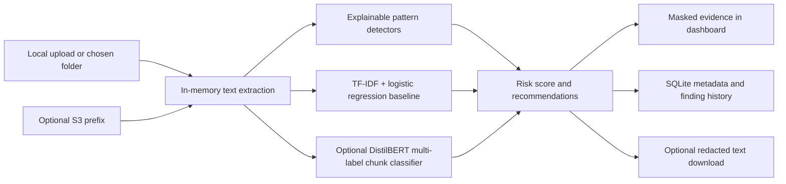

# AegisData - AI-assisted cloud data discovery and protection

A portfolio project inspired by the first project concept in the supplied internship-context document. It scans small local documents and, optionally, a narrowly scoped Amazon S3 prefix; detects common personal-data and credential patterns; combines a TF-IDF baseline with an optional locally fine-tuned DistilBERT multi-label classifier; OCRs sparse-text PDF pages when configured; explains risk; masks evidence; and keeps an audit-friendly metadata history.

**This is a learning prototype, not a production DLP/DSPM control.** It uses only synthetic demo data by default. It does not call a hosted LLM, upload data, change source files, or automatically remediate cloud objects.

## 1. Technology stack

| Layer | Technology | Why it is here |
|---|---|---|
| Language | Python 3.12 recommended | Clear security tooling ecosystem and a straightforward local workflow |
| Dashboard | Streamlit | Upload and review scans in a small local web UI |
| ML baseline | scikit-learn: TF-IDF + logistic regression | A fast, inspectable binary context classifier that works without model downloads |
| Optional deep ML | PyTorch + Hugging Face Transformers: fine-tuned DistilBERT | Local multi-label document/chunk signals for credentials, payment, government ID, contact, health, and financial-account context |
| Exact-value detection | Python regular expressions plus Luhn check | Explainable detectors for common emails, US phone/SSN candidates, card numbers, and token/secret formats |
| Persistence | SQLite | Local scan history without a separate database service |
| File parsing | Python standard library + pypdf | Text, Markdown, CSV, JSON, and digital PDF text extraction |
| Optional OCR | pypdfium2 + pytesseract + Tesseract OCR | Render sparse-text PDF pages locally and recognize image-only text |
| Optional cloud source | boto3 and Amazon S3 | Read-only listing and retrieval from a selected bucket prefix |
| Local S3 practice | Moto server | Exercise the same boto3 S3 path against localhost without an AWS account |
| Synthetic training data | Included deterministic generator | Reproducible, non-sensitive starter data with no external dataset download |

The Streamlit installer documentation currently lists Python 3.10-3.14 support and recommends an isolated environment; the project uses that environment pattern. The scikit-learn install guide also recommends isolated environments. [Streamlit setup guide](https://docs.streamlit.io/get-started/installation/command-line), [scikit-learn install guide](https://scikit-learn.org/stable/install)

## 2. What happens during a scan



The baseline estimates whether context resembles sensitive-data text. If the optional transformer has been trained, it adds category-specific document/chunk scores. The rules detect exact values and formats and remain the only source of exact-match evidence. A high model score with no exact match is a review prompt, not proof that the file contains regulated data. The model scores are not calibrated breach probabilities.

## 3. Project layout

```text
aegisdata/
├── aegisdata/
│   ├── classifier.py       # train and evaluate the synthetic text classifier
│   ├── cli.py              # local folder, evaluation, and optional S3 commands
│   ├── config.py           # paths, file-size limits, supported formats
│   ├── detectors.py        # explainable rules, safe evidence masking, redaction
│   ├── extractors.py       # in-memory extraction and optional local PDF OCR
│   ├── models.py           # scan and finding data objects
│   ├── scanner.py          # joins extraction, detection, and risk scoring
│   ├── storage.py          # SQLite schema and queries
│   └── transformer_model.py # optional local transformer inference
├── data/
│   ├── synthetic_training.csv
│   └── synthetic_multilabel.csv
├── models/                 # local fine-tuned weights; ignored by Git
├── docs/
│   ├── PROJECT_WALKTHROUGH.md
│   └── s3-read-only-policy.json
├── samples/demo_docs/      # deliberately synthetic scan examples
├── scripts/
│   ├── generate_synthetic_corpus.py
│   ├── generate_multilabel_corpus.py
│   ├── train_transformer.py
│   └── seed_local_s3.py
├── streamlit_app.py
├── requirements-ml.txt
├── requirements-ocr.txt
└── requirements.txt
```

## 4. Run it in VS Code on Windows

Open the `aegisdata` folder in VS Code. Open **Terminal -> New Terminal** and use **PowerShell**. Check that Python 3.12 is available:

```powershell
py -3.12 --version
```

If that command is unavailable, install Python 3.12 or another supported Python release, then reopen VS Code. Streamlit's current command-line setup guide lists supported Python releases and the standard `venv` workflow.

Create a project-only environment:

```powershell
py -3.12 -m venv .venv
```

Activate it:

```powershell
.\.venv\Scripts\Activate.ps1
```

If PowerShell blocks activation, allow it only for this terminal process, then activate again:

```powershell
Set-ExecutionPolicy -Scope Process -ExecutionPolicy Bypass
.\.venv\Scripts\Activate.ps1
```

Install the packages:

```powershell
python -m pip install --upgrade pip
python -m pip install -r requirements.txt
```

The synthetic corpus is already included. You can regenerate it at any time with the same seed:

```powershell
python .\scripts\generate_synthetic_corpus.py --rows-per-class 250 --seed 42
```

Create the local database:

```powershell
python -m aegisdata.cli init-db
```

Run the included sample folder scan:

```powershell
python -m aegisdata.cli scan-directory --path .\samples\demo_docs
```

Start the dashboard:

```powershell
python -m streamlit run .\streamlit_app.py
```

Streamlit prints a local address, normally `http://localhost:8501`; open it in your browser. Upload the same synthetic sample files in **Scan files** to see masked evidence and download a redacted `.txt` copy. To stop the local server, focus the VS Code terminal and press `Ctrl+C`.

### If activation is inconvenient

You can call the virtual-environment interpreter explicitly instead of activating it:

```powershell
.\.venv\Scripts\python.exe -m pip install -r requirements.txt
.\.venv\Scripts\python.exe -m aegisdata.cli init-db
.\.venv\Scripts\python.exe -m streamlit run .\streamlit_app.py
```

In VS Code, select the environment with **Ctrl+Shift+P -> Python: Select Interpreter -> `.venv`** so the editor uses the same packages as the terminal.

## 5. Put the project on GitHub

Install Git if needed, then run these commands from the project root after reviewing the files:

```powershell
git init
git add .
git status --short
git commit -m "Build AegisData cloud data protection prototype"
git branch -M main
git remote add origin https://github.com/YOUR-USERNAME/aegisdata.git
git push -u origin main
```

Create an empty repository on GitHub first and replace `YOUR-USERNAME`. Check `git status --short` before committing; the local database and AWS secrets/config are excluded by `.gitignore`. Do not commit real scanned files, credentials, personal data, or employer material.

## 6. Commands to explore

Evaluate the model on a deterministic held-out split of the included synthetic corpus:

```powershell
python -m aegisdata.cli evaluate
```

Scan another local folder you are authorized to inspect:

```powershell
python -m aegisdata.cli scan-directory --path "C:\path\to\your\authorized\demo-files"
```

You can change the local database path for a terminal session:

```powershell
$env:AEGIS_DB_PATH = ".\data\practice.db"
python -m aegisdata.cli init-db
```

To reset the default demo history, stop the app and remove only `data/aegisdata.db` from this project. The synthetic training CSV is separate and will remain.

## 7. S3 practice without an AWS account

You do not need AWS to learn the S3 scanning flow. Moto starts a local S3-compatible mock server; the app points boto3 at `127.0.0.1`, so requests stay on your computer. Moto is an emulator, not a real AWS environment. Its server mode is documented for use with SDK endpoint URLs. [Moto server mode](https://docs.getmoto.org/en/stable/docs/server_mode.html), [Moto S3 support](https://docs.getmoto.org/en/stable/docs/services/s3.html)

In VS Code Terminal 1, install the optional Moto server package and start it:

```powershell
python -m pip install -r requirements-local-s3.txt
moto_server -H 127.0.0.1 -p 5000
```

Leave that terminal open. In Terminal 2, from the project root, seed only the included synthetic files and scan the local bucket:

```powershell
python .\scripts\seed_local_s3.py
python -m aegisdata.cli scan-s3 --bucket aegisdata-demo --prefix demo/ --region us-east-1 --endpoint-url http://127.0.0.1:5000 --max-objects 25
```

Stop the Moto server with `Ctrl+C`. The seed script rejects non-local endpoints, and the scanner uses dummy credentials whenever `--endpoint-url` is set. This workflow creates no AWS resources or AWS bill. It uses CPU, memory, and local disk on your computer.

## 8. Optional real AWS S3 demonstration

You do not need this step for the project. If you later use real S3, use a test bucket and synthetic files that you own or are explicitly allowed to scan. The connector lists objects under one prefix and reads supported objects; it never uploads, tags, deletes, or changes bucket settings. boto3 uses the AWS profile/credential chain configured on your machine. [Boto3 credentials guide](https://boto3.amazonaws.com/v1/documentation/api/latest/guide/credentials.html)

Amazon S3 is pay-as-you-go: storage, requests, retrievals, and some transfers/features can be chargeable. [AWS S3 pricing](https://aws.amazon.com/s3/pricing/) If you have no AWS account and run the local Moto steps above, you cannot incur an AWS S3 charge from this project. AWS currently advertises a Free plan for new accounts with up to $200 in credits over 6 months and says the Free plan is not charged unless you convert to a Paid plan or activate paid-only services; eligibility and service limits apply. You can skip creating an AWS account entirely for this build. [AWS Free Tier details](https://aws.amazon.com/free/)

1. Create a demo bucket or use an authorized test bucket, and upload only synthetic files under a prefix such as `demo/`.
2. Create an identity policy based on [`docs/s3-read-only-policy.json`](docs/s3-read-only-policy.json). Replace the bucket and prefix placeholders. It grants `s3:ListBucket` for that prefix and `s3:GetObject` for objects under it; do not add write access for this prototype. S3 uses `ListObjectsV2` for enumeration and `GetObject` for object reads. [S3 required permissions](https://docs.aws.amazon.com/AmazonS3/latest/userguide/using-with-s3-policy-actions.html)
3. Configure an AWS IAM Identity Center profile using the AWS CLI v2 if your account provides one:

   ```powershell
   aws configure sso --profile aegis-readonly
   aws sso login --profile aegis-readonly
   ```

4. Scan a small prefix with a cap:

   ```powershell
   python -m aegisdata.cli scan-s3 --bucket YOUR-DEMO-BUCKET --prefix demo/ --region ap-south-1 --profile aegis-readonly --max-objects 25
   ```

The object contents are read into the local process for extraction. The database stores the object URI and metadata, not the raw body. Avoid scanning broad buckets: use a narrow prefix and a small `--max-objects` value. Objects larger than the configured size limit are skipped. A customer-managed KMS-encrypted object may require a separately scoped decrypt permission; this example policy does not grant it.

## 9. Optional deep-learning classifier

The existing TF-IDF/logistic-regression classifier remains the lightweight baseline. The optional DistilBERT model adds a multi-label score for seven categories: cloud credentials, payment cards, government IDs, email addresses, phone numbers, health information, and financial accounts. It scores overlapping text chunks and keeps the highest score per category. The existing exact-value rules still supply masked evidence and offsets.

From the project root, use a VS Code terminal:

```powershell
python -m pip install -r requirements-ml.txt
python .\scripts\generate_multilabel_corpus.py
python .\scripts\train_transformer.py --epochs 2 --batch-size 4
```

The first training run downloads the pretrained `distilbert/distilbert-base-uncased` weights from Hugging Face. Training uses only the included synthetic corpus and runs locally; it does not send scanned documents anywhere and does not use AWS. CPU training can take several minutes or longer. A CUDA-capable PyTorch setup can use an available NVIDIA GPU, but is not required. The trained model is saved under `models/aegisdata-distilbert/`; restart Streamlit and the app loads it automatically. If the model folder is absent, the app keeps using the baseline.

The generated corpus includes category labels and a `template_group`. Training, validation, and test groups are separated so near-duplicate variants of one template do not cross split boundaries. The training script prints and saves per-category precision, recall, and F1 at a 0.50 threshold. Those figures describe only this generated synthetic corpus; they are not evidence of real-world performance. Improve the corpus with separately authored or appropriately licensed examples before making effectiveness claims.

At inference, model probabilities are review signals. A model category is not an exact-match finding; it may be a false positive or miss content. No token-classification/NER model has been trained in this version, so contextual category scores do not create new redaction spans. Rules continue to produce exact offsets.

## 10. OCR for scanned PDFs

Text-based PDFs use direct extraction. When a page yields fewer than 24 characters, AegisData treats it as possibly scanned and runs local OCR on that page. It uses pypdfium2 to render the page and Tesseract to recognize text. The original PDF is not changed. OCR text is passed through the same rules and classifiers as other extracted text, and the redacted download is a text copy.

Install the optional Python packages inside the project's virtual environment:

```powershell
python -m pip install -r requirements-ocr.txt
```

Tesseract itself is a separate Windows application. Install a current Windows build linked from the [official Tesseract installation guide](https://tesseract-ocr.github.io/tessdoc/Installation.html), make sure English language data is selected, and add its install directory to Windows `PATH` if the installer does not do that automatically. Close and reopen VS Code, then confirm:

```powershell
tesseract --version
```

The default limits are 40 PDF pages and 20 OCR pages per file. You can adjust them for a terminal session:

```powershell
$env:AEGIS_MAX_PDF_PAGES = "60"
$env:AEGIS_MAX_OCR_PAGES = "40"
$env:AEGIS_OCR_DPI = "250"
```

If Tesseract is installed but not on `PATH`, set its executable path for the current terminal, then launch Streamlit from that terminal:

```powershell
$env:AEGIS_TESSERACT_CMD = "C:\Program Files\Tesseract-OCR\tesseract.exe"
```

OCR quality depends on scan resolution, contrast, rotation, handwriting, and layout. Tables and multi-column pages may be read in the wrong order. Review OCR-derived findings before relying on them. Tesseract performs OCR locally; it does not upload the page image. [PyTesseract requires the Tesseract application](https://pytesseract.readthedocs.io/en/latest/), and pypdfium2 renders PDF pages for image processing. [pypdfium2 project](https://pypi.org/project/pypdfium2/)

## 11. How the scores work

- **Rule match:** each match has a category, rule identifier, confidence value, severity, masked category label/offset, and a suggested next step.
- **Context score:** the baseline returns a probability for sensitive context. When the transformer artifact exists, the app also scores seven categories over text chunks and stores those signals separately.
- **Risk score:** exact credential/card/ID matches start higher than contact information. Transformer category scores can raise a review score but do not create exact-value matches. Multiple exact categories add a small capped bonus.
- **Label:** the numeric score maps to Low, Medium, High, or Critical. These are triage labels chosen for this demo, not a compliance standard.
- **Evidence masking:** the report stores a category placeholder and text offsets, not surrounding source text. This prevents an unrelated, unrecognized secret next to a finding from being copied into SQLite. Original file bodies are not stored.

The rules cover a small set of formats, including email addresses, US phone and SSN candidates, Luhn-valid payment-card candidates, common token prefixes, key headers, and simple credential assignments. Rule matches can be wrong; missing a rule pattern is not evidence that a file is safe.

## 12. Evaluation and honest reporting

`python -m aegisdata.cli evaluate` reports accuracy, precision, recall, and F1 on a reproducible 25% holdout split. That split is drawn from generated synthetic text. Its metrics measure whether the demo model learned that synthetic corpus; they do **not** estimate real-world DLP performance, cloud coverage, or performance on new organizations.

For stronger evidence before adding metrics to a resume:

1. Create a separate, authorized evaluation corpus with clear labels and no sensitive production data.
2. Keep duplicate templates and near-duplicates from leaking across train and holdout sets.
3. Report per-category precision and recall, false positives per 1,000 documents, scan throughput, and the exact dataset size/split.
4. Compare the model-only, rules-only, and combined results.
5. Save the dataset description and commands so someone else can reproduce the results.

Do not put an accuracy number on a resume until you have run a meaningful evaluation and can explain what the test set contained.

## 13. Resume wording

After you run the project and understand each component, a defensible starting bullet is:

> Built a local-first cloud data discovery prototype in Python with Streamlit, combining explainable PII/secret rules, a scikit-learn baseline, and an optional fine-tuned DistilBERT multi-label classifier; added local OCR for scanned PDF pages, masked evidence, grouped synthetic-data evaluation, SQLite scan history, and an optional read-only S3 workflow.

Only add measured precision, recall, throughput, or cloud-scale claims after you have produced and documented those measurements yourself. Do not imply this is Zscaler software or that you used Zscaler confidential information.

## 14. Boundaries and next steps

- OCR depends on a separate Tesseract installation and may misread low-quality scans, handwriting, tables, or multi-column layouts.
- It recognizes only selected patterns and mostly US-specific identifier formats.
- Both models train on synthetic text; transformer scores do not establish production detection effectiveness.
- The transformer predicts document/chunk categories, not exact PII spans. Exact redaction evidence still comes from rules; a trained token-classification model remains a possible later extension.
- There is no authentication, multi-user access control, hosted deployment, alert queue, or automatic remediation.
- The S3 connector is read-only, but the operator still needs authorization and must choose a safe source.
- The local SQLite database retains names/URIs, hashes, masked finding labels/offsets, and risk metadata. Protect or remove it if filenames or locations are sensitive.

Good next milestones: add a carefully licensed benchmark with documented data handling; train a token-classification model on span-labeled examples; add a review/false-positive feedback loop; and measure OCR and model performance on a distinct held-out set before changing the resume claims.
